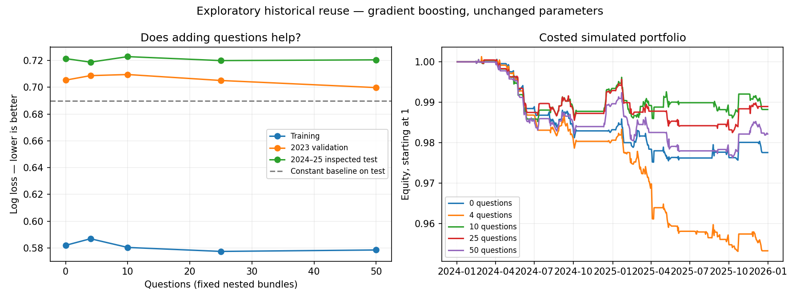

# Fifty-question exploratory experiment

Exploratory reuse of previously inspected historical periods; not a new untouched test.

Original four cached probabilities are held fixed; 46 new questions are added. All 50 were asked per new API call. Repeated originals measure batch-context stability only.

| Learner | Questions | Numeric inputs | Train log loss | Validation log loss | Inspected-test log loss | Net simulated return | Trades |
|---|---:|---:|---:|---:|---:|---:|---:|
| boosting | 0 | 193 | 0.58196 | 0.70532 | 0.72141 | -2.24% | 44 |
| boosting | 4 | 201 | 0.58690 | 0.70870 | 0.71875 | -4.68% | 62 |
| boosting | 10 | 224 | 0.58039 | 0.70952 | 0.72288 | -1.18% | 53 |
| boosting | 25 | 256 | 0.57743 | 0.70506 | 0.71992 | -1.11% | 47 |
| boosting | 50 | 308 | 0.57849 | 0.69975 | 0.72048 | -1.79% | 57 |
| logistic | 0 | 193 | 0.59910 | 0.80725 | 0.92675 | -0.09% | 56 |
| logistic | 4 | 201 | 0.59286 | 0.84976 | 0.93355 | -0.66% | 55 |
| logistic | 10 | 224 | 0.58664 | 0.94232 | 0.94881 | -0.89% | 52 |
| logistic | 25 | 256 | 0.57606 | 0.97877 | 0.97703 | -1.46% | 54 |
| logistic | 50 | 308 | 0.54568 | 1.09262 | 1.02385 | -0.39% | 41 |

Constant training-prior baseline inspected-test log loss: 0.68976.

Paired differences below are 50 questions minus comparator; negative log-loss differences favor 50.

- boosting__50_minus_0: -0.00093; approximate 95% date-block interval [-0.014505603219581338, 0.012724911819893969].
- boosting__50_minus_4: +0.00173; approximate 95% date-block interval [-0.009025795529506763, 0.012762829550954372].
- logistic__50_minus_0: +0.09710; approximate 95% date-block interval [0.03415308613646507, 0.15669420873970782].
- logistic__50_minus_4: +0.09030; approximate 95% date-block interval [0.03097331294267255, 0.14797243928308804].

Inference: 1560 documents × 50 questions; estimated $0.9023 at configured published pricing. Successful requests only; failed calls may cost extra.
Median recorded request latency: 0.625s. Repeated original-question choice agreement: 99.76%.
API selected-label/argmax inconsistencies: 8; raw responses preserved, only validated probability distributions used by predictors.

Training 2018–2022 (1,088 events), validation 2023 (138), previously inspected test 2024–2025 (321). Next-session entry and five-session holding period, original cost and risk assumptions unchanged.

## Limits

- Previously inspected 2024–2025 data; exploratory comparison, not fresh confirmation.
- Question count ordering is fixed but not random; this compares particular feature bundles.
- Only original financing-selected 8-K primary text, no prior filings or exhibits added.
- New questions have no comprehensive independent accuracy or calibration audit.
- Current-universe survivorship bias, retrospective adjusted prices, unknown model training cutoff.
- All original learner parameters, horizon and portfolio assumptions kept fixed.
- Intervals are descriptive, not adjusted for multiple comparisons or adaptive research.
- Simulated daily-open proxies with costs, not executable trading results.

