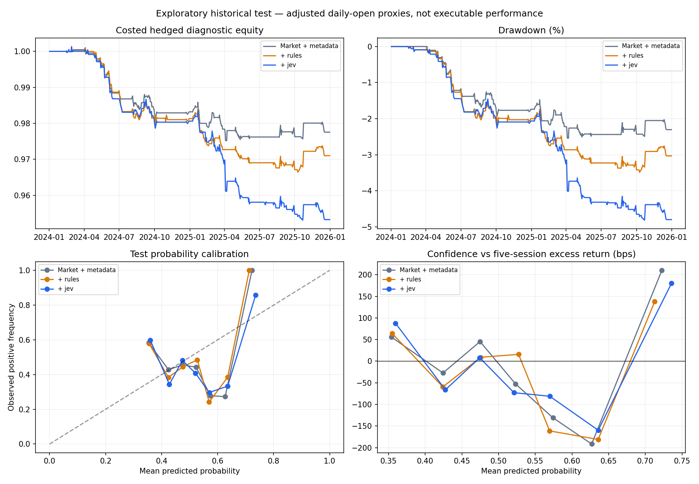

# Large historical predictive study

Primary comparison does not establish an improvement from Jev features; the interval includes zero.

Matched events: {'test': 321, 'train': 1088, 'validation': 138}; 129 issuers.

Target: positive asset-minus-SPY adjusted return from the next session open through five trading sessions later.
Training: 2018–2022; validation: 2023; test: 2024–2025. Labels crossing split boundaries were purged.

| Model | Test log loss ↓ | Brier ↓ | AUC ↑ | Accuracy |
|---|---:|---:|---:|---:|
| boosting__market_and_metadata | 0.72141 | 0.26374 | 0.428 | 47.0% |
| boosting__market_metadata_rules | 0.71788 | 0.26193 | 0.441 | 48.9% |
| boosting__market_metadata_jev | 0.71875 | 0.26231 | 0.440 | 48.3% |
| logistic__market_and_metadata | 0.92675 | 0.30190 | 0.483 | 49.5% |
| logistic__market_metadata_rules | 0.92670 | 0.30041 | 0.489 | 51.1% |
| logistic__market_metadata_jev | 0.93355 | 0.30651 | 0.472 | 48.3% |
| train_class_prior | 0.68976 | 0.24831 | 0.500 | 54.8% |
| uniform | 0.69315 | 0.25000 | 0.500 | 45.2% |

Primary paired log-loss difference (Jev − baseline): **-0.00266**, approximate 95% interval **[-0.01542, +0.01022]** using 20-session date blocks.

## Costed portfolio diagnostic

Each selected event holds 5% equity long the stock and 5% short SPY for five sessions, with no overlapping positions in the same issuer and a 100% gross entry limit. Entry requires probability at or above that model’s 2023 validation 80th percentile. Costs: 5 bps per leg per side plus 100 bps/year short borrowing. A 20% drawdown stops new entries while the drawdown persists.

| Model | Trades | Net return | Max drawdown |
|---|---:|---:|---:|
| boosting__market_and_metadata | 44 | -2.24% | -2.54% |
| boosting__market_metadata_rules | 56 | -2.90% | -3.49% |
| boosting__market_metadata_jev | 62 | -4.68% | -4.81% |
| logistic__market_and_metadata | 56 | -0.09% | -1.80% |
| logistic__market_metadata_rules | 58 | -0.27% | -1.69% |
| logistic__market_metadata_jev | 55 | -0.66% | -1.99% |

These are adjusted daily-open proxies, not fillable quotes; no capacity or locate model is included.

## Limitations

- Current convenience universe has survivorship and issuer identity biases.
- Retrospective adjusted prices and pretrained text model may contain later information.
- Prices are daily bar proxies, not executable quotes.
- Only four audited disclosure concepts are tested, not arbitrary text value.
- No test-label tuning; all sources are historical.
- Four text features do not test the value of all possible language-model inputs.
- Issuer/date dependence is approximated by 20-session blocks; intervals are exploratory, not proof.
- No tuning after viewing test results; secondary learner/rules/year analyses are descriptive.
- Portfolio equity is a costed hedged diagnostic with approximate adjusted daily opens, no execution validation.

## Saved evidence

config.json and evaluation_code.py preserve the specification and code; feature_columns.json defines model inputs; test_predictions.csv preserves every prediction; excluded_events.json records every dropped case. The raw sources and inference responses remain in data/large_study_v1.

Estimated total inference cost: $0.2392; 1560 documents. This is usage-based estimation, not a billing receipt.

